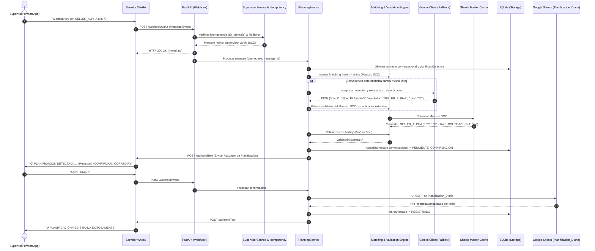
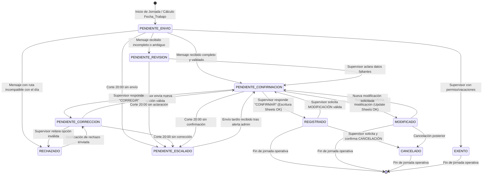

> ⚠️ **DOCUMENTO OBSOLETO.** Se conserva solo como referencia histórica del diseño inicial. El estado actual del proyecto está en el código y en REQUIREMENTS.md.

# ARCHITECTURE.md - Arquitectura Técnica y Decisiones de Diseño
## Proyecto: Supervisor Planner (Bot de Planificación Comercial WhatsApp)

---

### 1. Resumen Ejecutivo y Objetivos

El sistema **Supervisor Planner** es una solución backend automatizada de alta fiabilidad orientada a capturar, interpretar, validar, confirmar y consolidar la planificación diaria de **5 supervisores comerciales** de Company en tres sedes operativas de Bolivia:
* **Santa Cruz (SCZ)**: 2 supervisores.
* **La Paz / El Alto (LPZ-EA)**: 2 supervisores.
* **Cochabamba (CBBA)**: 1 supervisor.

El canal de comunicación es WhatsApp, implementado a través de **WAHA (WhatsApp HTTP API)** en conversaciones privadas individuales. El sistema se apoya en **Google Sheets** como maestro de datos maestros y repositorio final de consolidación (`Planificacion_Diaria`), **SQLite** como motor de persistencia transaccional y estado conversacional local para el MVP, **Gemini API** como motor auxiliar de procesamiento de lenguaje natural (sin autoridad de validación) y un **Scheduler** para recordatorios proactivos y escalamiento.

---

### 2. Principio Arquitectónico Rector: "Python es la Autoridad, la IA es el Asistente"

```
                     ┌───────────────────────────────┐
                     │   Mensaje WhatsApp (WAHA)     │
                     └───────────────┬───────────────┘
                                     │
                                     ▼
                     ┌───────────────────────────────┐
                     │ FastAPI Webhook (Idempotencia)│
                     └───────────────┬───────────────┘
                                     │
            ┌────────────────────────┴────────────────────────┐
            ▼                                                 ▼
┌──────────────────────────────┐              ┌──────────────────────────────┐
│  Matching Determinístico      │              │   Gemini Client (Auxiliar)   │
│  - Exacto                    │              │   - Extracción de intención  │
│  - Normalizado (tildes/case) │   Si falla   │   - Entidades en texto bruto │
│  - Fuzzy (RapidFuzz >= 85)   ├─────────────►│   - Clasificación modalidad  │
└───────────────┬──────────────┘              └───────────────┬──────────────┘
                │ Coincidencia clara                          │ Propuesta
                └───────────────────────┬─────────────────────┘
                                        ▼
                     ┌───────────────────────────────────────┐
                     │  MOTOR DE NEGOCIO PYTHON (AUTORIDAD)  │
                     │  - Sede vinculada a teléfono          │
                     │  - Cálculo Fecha_Trabajo y DIA        │
                     │  - Validación Ruta vs Día en Maestro  │
                     │  - Extracción de ERP, Zona, Código    │
                     │  - Reglas por Modalidad               │
                     └──────────────────┬────────────────────┘
                                        │
                         ¿Pasa validación de negocio?
                                       / \
                                 Sí   /   \  No
                                     /     \
                                    ▼       ▼
                     ┌──────────────────┐ ┌──────────────────┐
                     │ Enviar Resumen   │ │ Rechazo Formal   │
                     │ Confirmación al  │ │ Motivo detallado │
                     │ Supervisor       │ │ (No altera plan) │
                     └─────────┬────────┘ └──────────────────┘
                               │
                       Supervisor CONFIRMA
                               │
                               ▼
                     ┌───────────────────────────────────────┐
                     │  Escritura en Google Sheets (UPSERT)  │
                     │  Persistencia en SQLite (Auditoría)   │
                     │  Estado: REGISTRADO / MODIFICADO      │
                     └───────────────────────────────────────┘
```

#### Reglas de Oro:
1. **Gemini nunca decide**:
   * Fecha de trabajo ni código de día (`DIA`).
   * Código ERP del vendedor.
   * Código oficial de ruta ni zona.
   * Validez de la relación ruta-día.
   * Estado de la transacción ni persistencia.
2. **Los datos oficiales provienen exclusivamente de los Maestros de Google Sheets** correspondientes a la sede del supervisor.
3. **Ninguna fila se inserta o modifica en Google Sheets sin la confirmación explícita del supervisor**.
4. **Una modificación inválida nunca sobrescribe ni destruye una planificación previa ya registrada**.

---

### 3. Decisiones Técnicas y Resolución de Ambigüedades de SPEC.md

| Área | Ambigüedad / Pregunta en SPEC | Decisión Técnica Formal | Razón / Fundamento |
| :--- | :--- | :--- | :--- |
| **Identificación de Maestros** | Se mencionan 3 nombres: `PLANIFICACION_SCZ_RENOM`, `PLANIFICACION_LPZ`, `VENDEDORES_CBBA`. | Se estructuran como **hojas (worksheets/tabs)** dentro de un único Google Spreadsheet definido por `GOOGLE_SPREADSHEET_ID`. Se configuran nombres de pestaña vía `.env`: `GOOGLE_WORKSHEET_SCZ`, `GOOGLE_WORKSHEET_LPZ`, `GOOGLE_WORKSHEET_CBBA`. | Reduce cuotas de API de Google Drive, centraliza permisos de Service Account en un único documento y facilita el mantenimiento administrativo. |
| **Persistencia de Supervisores** | "No hardcodear números dentro de la lógica... usar configuración externa". | Archivo `supervisors.json` (versionado/plantilla) y tabla SQLite `supervisors` inicializada en el bootstrap. El archivo contendrá teléfono, nombre, sede (`SCZ`, `LPZ-EA`, `CBBA`) y flag `activo`. | Permite añadir o modificar supervisores sin tocar código ni reiniciar la aplicación si se expone una recarga. |
| **Integración con WAHA** | Evitar endpoints obsoletos o inventados de WAHA. | Uso de la API oficial de **WAHA (WhatsApp HTTP API - Core/Plus)**: webhook receptor en `POST /webhook/waha` procesando el evento `message` (`payload.from`, `payload.id`, `payload.body`, `payload.fromMe`). Envío de mensajes vía `POST {WAHA_BASE_URL}/api/sendText` con cabecera `X-Api-Key: {WAHA_API_KEY}` y cuerpo `{"session": WAHA_SESSION, "chatId": "...", "text": "..."}`. | Alineado exactamente con la documentación v2024/2025 de WAHA. |
| **Cliente de Gemini** | "No asumir nombre de modelo sin comprobar". | Uso del SDK moderno oficial `google-genai` con modelo configurable vía `.env` (`GEMINI_MODEL=gemini-2.5-flash` o `gemini-1.5-flash`), `temperature=0.0`, `response_mime_type="application/json"` y `response_schema` basado en Pydantic. | Garantiza cero alucinaciones en estructura y tiempo de respuesta sub-segundo. |
| **Cálculo de `Fecha_Trabajo` (Corte 08:30)** | Lunes 00:00 a 08:30 vs Lunes después de 08:30. | Comparación exacta con timezone `America/La_Paz`: Lunes `<= 08:30:00` -> Mismo Lunes. Lunes `> 08:30:00` -> Martes. Viernes, Sábado y Domingo -> Próximo Lunes. Se parametriza `MONDAY_CUTOFF_TIME="08:30"` en `.env`. | Regla operacional estricta de despacho y carga comercial de Company. |
| **Días del Maestro** | Formato de día en maestros: `1-LU`, `2-MA`, `3-MI`, `4-JU`, `5-VI`, `6-SA`. | Función `get_weekday_code(date: date) -> str`. Mapeo determinístico ISO: Lunes=1 (`1-LU`) a Sábado=6 (`6-SA`). Domingo genera error/excepción de negocio (no hay rutas dominicales). | Estricta correspondencia con las claves foráneas operativas de Company. |
| **Manejo de Modalidad Oficina** | `OFICINA` no tiene ruta ni vendedor en el maestro. | Para modalidad `OFICINA`: `Ruta_Oficial="OFICINA"`, `Zona="N/A"`, `Codigo_Ruta="N/A"`, `Vendedor_Apoyo="N/A"`, `Codigo_ERP_Vendedor="N/A"`, `DIA="N/A"`. Se omite la validación de día. | Exigido expresamente en la Sección 11 de `SPEC.md`. |
| **Manejo de Venta Directa** | `VENTA DIRECTA` requiere ruta pero no vendedor. | Para modalidad `VENTA DIRECTA`: `Vendedor_Apoyo="VENTA DIRECTA"`, `Codigo_ERP_Vendedor="N/A"`. La ruta se valida obligatoriamente contra el maestro de la sede y debe coincidir con el `DIA` de trabajo. | Exigido expresamente en la Sección 11 de `SPEC.md`. |
| **UPSERT en Google Sheets** | "¿Cómo evitar filas duplicadas manteniendo historial?". | La clave lógica unívoca de planificación activa es `Fecha_Trabajo + Sede + Supervisor`. Se busca en `Planificacion_Diaria` una fila con dicho trinomio y estado activo. Si existe, se ejecuta UPDATE de esa fila en Google Sheets. Si no existe, se hace APPEND (INSERT). En SQLite se almacena el `sheet_row_number` para agilizar la actualización in-place. | Cumple la regla de Sección 18: "Máximo una planificación activa. Primer registro: INSERT. Corrección posterior: UPDATE". |
| **Reintentos y Fallos en Sheets** | Si Google Sheets está caído al confirmar. | Si el intento de escritura en Google Sheets falla tras 3 reintentos con exponential backoff: la transacción en SQLite queda en `PENDIENTE_CONFIRMACION_ERROR_SHEETS` o se mantiene en memoria/cola, el estado NO pasa a `REGISTRADO`, se avisa al supervisor que hubo un retraso de conexión y se dispara alerta inmediata al teléfono del Administrador (`ADMIN_PHONE`). | Cumple la regla crítica de Sección 33 y 50: nunca confirmar éxito al supervisor sin confirmación de escritura real. |
| **Scheduler de Recordatorios** | Ejecución cada 15 min y corte 20:00. | Tarea asíncrona periódica (vía `APScheduler` en background dentro de FastAPI) cada 15 minutos en horario operativo. Solo evalúa a los 5 supervisores registrados. Verifica `last_reminder_at` para respetar ventanas de 15 minutos exactos. Al pasar las 20:00 (`REMINDER_END_TIME`), marca `PENDIENTE_ESCALADO` y envía alerta de resumen de incumplimiento al Administrador. | Sección 25, 26, 27 y 28 de `SPEC.md`. |

---

### 4. Estructura de Carpetas y Archivos del Proyecto

```
supervisor-planner/
├── .env.example                  # Plantilla de variables de entorno exhaustiva
├── .gitignore                    # Reglas Git (ignora .env, credenciales, db, logs)
├── Dockerfile                    # Contenedor optimizado Python 3.11-slim
├── docker-compose.yml            # Orquestación de app FastAPI + WAHA
├── requirements.txt              # Dependencias de producción estrictamente versionadas
├── README.md                     # Documentación de instalación y operaciones
├── ARCHITECTURE.md               # Este documento de diseño y arquitectura
├── PROGRESS.md                   # Bitácora de análisis, cobertura y fases
│
├── config/                       # Archivos de configuración externa
│   └── supervisors.json          # Datos maestros de los 5 supervisores (teléfono, sede, etc.)
│
├── app/
│   ├── __init__.py
│   ├── main.py                   # Entrypoint FastAPI, lifespans, registro de routers
│   ├── config.py                 # Settings Pydantic con validación de entorno
│   ├── dependencies.py           # Inyección de dependencias (DB, Repos, Clientes)
│   │
│   ├── api/                      # Capa de transporte HTTP
│   │   ├── __init__.py
│   │   ├── health.py             # GET /health, GET /status
│   │   └── webhook.py            # POST /webhook/waha (Recepción de WhatsApp)
│   │
│   ├── whatsapp/                 # Adaptador WAHA y formateo de mensajes
│   │   ├── __init__.py
│   │   ├── client.py             # Cliente HTTP asíncrono para enviar mensajes vía WAHA
│   │   ├── parser.py             # Extracción y limpieza de payloads WAHA
│   │   ├── templates.py          # Plantillas de texto WhatsApp (resúmenes, alertas, emojis)
│   │   └── handlers.py           # Router de eventos de WhatsApp
│   │
│   ├── ai/                       # Integración con Google Gemini
│   │   ├── __init__.py
│   │   ├── gemini_client.py      # Cliente desacoplado con retry y fallback
│   │   ├── prompts.py            # System prompts y Few-Shot examples para intención
│   │   └── schemas.py            # Esquemas Pydantic de salida estructurada
│   │
│   ├── business/                 # Core de Reglas de Negocio (Puro Python)
│   │   ├── __init__.py
│   │   ├── dates.py              # Cálculo de Fecha_Trabajo y get_weekday_code
│   │   ├── states.py             # Enums de estados y Máquina de Estados Finita (FSM)
│   │   ├── matching.py           # Normalización de strings, Fuzzy y reglas de coincidencia
│   │   ├── validation.py         # Validación Ruta vs Día, Vendedor vs Sede, Modalidad
│   │   └── planning_rules.py     # Lógica pura de planificación, modificación y cancelación
│   │
│   ├── sheets/                   # Integración con Google Sheets API / gspread
│   │   ├── __init__.py
│   │   ├── client.py             # Autenticación segura vía Service Account
│   │   ├── masters.py            # Gestor de caché y normalización de Maestros (SCZ, LPZ, CBBA)
│   │   └── planning_repository.py# Repositorio de lectura/UPSERT en Planificacion_Diaria
│   │
│   ├── database/                 # Persistencia Local SQLite
│   │   ├── __init__.py
│   │   ├── database.py           # Motor SQLAlchemy asíncrono / sqlite3 optimizado
│   │   ├── models.py             # Modelos ORM: supervisors, conversations, plannings, audit
│   │   └── repositories.py       # Consultas e inserciones transaccionales
│   │
│   └── services/                 # Servicios de Orquestación de Alto Nivel
│       ├── __init__.py
│       ├── supervisor_service.py # Verificación y autenticación de remitente por teléfono
│       ├── conversation_service.py# Gestión de contexto conversacional y memoria temporal
│       ├── planning_service.py   # Orquestador del ciclo completo de planificación
│       ├── reminder_service.py   # Lógica de cálculo y despacho de recordatorios
│       ├── audit_service.py      # Registro centralizado de LOG_BOT (DB + Sheets Log)
│       └── scheduler_service.py  # Planificador APScheduler para tareas periódicas
│
├── tests/                        # Batería de Pruebas Automatizadas
│   ├── __init__.py
│   ├── conftest.py               # Fixtures compartidas (mocks de Sheets, Gemini, WAHA)
│   ├── test_dates.py             # Pruebas unitarias de cálculo de fecha de trabajo (8 casos)
│   ├── test_matching.py          # Pruebas de normalización y matching determinístico
│   ├── test_validation.py        # Pruebas de validación de ruta/día y modalidades
│   ├── test_states.py            # Pruebas de transiciones permitidas e inválidas en la FSM
│   ├── test_upsert.py            # Pruebas de lógica de INSERT vs UPDATE y cancelación
│   ├── test_idempotency.py       # Pruebas de duplicidad de mensajes de WhatsApp
│   ├── test_reminders.py         # Pruebas de scheduler de 15 min y escalamiento 20:00
│   └── test_integration.py      # Simulación E2E de flujos conversacionales
│
└── scripts/                      # Scripts utilitarios y mantenimiento
    ├── test_sheets_connection.py # Validador de conexión y descarga de maestros
    ├── test_waha_connection.py   # Validador de sesión activa en WAHA
    └── test_gemini_connection.py # Validador de API key y prompt básico
```

---

### 5. Responsabilidades Claras por Módulo

| Módulo | Responsabilidad Primaria | Lo que NUNCA debe hacer |
| :--- | :--- | :--- |
| `api/webhook.py` | Recibir el webhook de WAHA, validar firma/autenticidad, descartar eventos ajenos o repetidos (`processed_messages`), responder `200 OK` de inmediato para evitar timeouts de WhatsApp y derivar el procesamiento asíncrono. | No ejecuta lógica de negocio, no consulta Google Sheets ni genera textos conversacionales. |
| `whatsapp/client.py` | Realizar llamadas HTTP salientes a la API de WAHA con reintentos para enviar mensajes de texto o interactivos a chats privados y grupos. | No decide cuándo enviar ni redacta los mensajes. |
| `business/dates.py` | Calcular unívocamente la `Fecha_Trabajo` (date) y el código `DIA` (str) según el reloj de `America/La_Paz` y la hora de corte de los lunes (08:30). | No interactúa con la base de datos ni con servicios de red. |
| `business/matching.py` | Implementar pipeline de búsqueda determinística en cascada (exacto -> tildes -> minúsculas -> fuzzy con RapidFuzz) sobre el catálogo de vendedores y rutas de la sede activa. | No asume nombres inexistentes ni recurre a IA si encuentra coincidencia unívoca. |
| `business/validation.py` | Validar que el día de la ruta coincida con el `DIA` de trabajo, que la modalidad cumpla sus requisitos y que el supervisor pertenezca a la sede. | No modifica datos maestros ni aprueba excepciones no contempladas. |
| `business/states.py` | Controlar las transiciones legales de la máquina de estados y bloquear cualquier flujo inconsistente. | No realiza persistencia por sí mismo. |
| `sheets/masters.py` | Descargar periódicamente los 3 maestros de Google Sheets, normalizarlos en memoria y exponer índices optimizados para búsqueda ultrarrápida por sede. | No consulta Google Sheets por cada mensaje recibido (utiliza caché en memoria con TTL o refresh programado). |
| `sheets/planning_repository.py`| Ejecutar operaciones de lectura y UPSERT (`insert_planning`, `update_planning`, `cancel_planning`) sobre la hoja `Planificacion_Diaria`. | No se ejecuta si el supervisor no ha emitido confirmación previa. |
| `ai/gemini_client.py` | Extraer intención (`NEW_PLANNING`, `CONFIRM`, `CORRECT`, `MODIFY_SELLER`, `MODIFY_ROUTE`, `CANCEL`, `OFFICE`, `DIRECT_SALE`, `UNKNOWN`) y entidades textuales sin normalizar cuando el matching determinístico no es suficiente. | No emite códigos oficiales ERP, ni códigos de ruta, ni valida días de la semana. |
| `services/planning_service.py` | Orquestar el flujo integral: autenticar supervisor -> consultar estado actual -> resolver intención -> normalizar entidades -> validar negocio -> pedir confirmación -> ejecutar UPSERT. | No acopla detalles de bajo nivel de protocolos HTTP o SQL. |

---

### 6. Relación e Interacción de Componentes



---

### 7. Modelo de Estados de la Planificación y del Flujo Conversacional

El ciclo de vida de la planificación de un supervisor para una fecha de trabajo determinada se modela mediante la siguiente máquina de estados finita (FSM):



#### Descripción Detallada de Estados:
1. `PENDIENTE_ENVIO`: Estado inicial. No se ha recibido ninguna propuesta para la fecha calculada. Candidato a recordatorios periódicos.
2. `PENDIENTE_REVISION`: Se recibió información pero faltan parámetros requeridos (ej. falta el vendedor en acompañamiento) o hay múltiples coincidencias (ambigüedad). El bot formuló una pregunta puntual.
3. `PENDIENTE_CONFIRMACION`: Propuesta 100% validada por reglas de negocio. Se presentó la ficha resumen al supervisor y se espera su "CONFIRMAR" o "CORREGIR". Candidato a recordatorios de confirmación.
4. `RECHAZADO`: Transición técnica momentánea ocurrida cuando una ruta propuesta no corresponde al día de trabajo o se vulnera una regla de negocio. Se emite explicación al supervisor.
5. `PENDIENTE_CORRECCION`: Estado resultante tras un rechazo o cuando el supervisor eligió "CORREGIR". Candidato a recordatorios de corrección.
6. `REGISTRADO`: Estado exitoso definitivo. El supervisor confirmó y la fila fue insertada con éxito en Google Sheets. Se suspenden los recordatorios.
7. `MODIFICADO`: Estado exitoso tras una alteración posterior sobre un registro previo. La fila existente en Google Sheets fue actualizada in-place. Se suspenden los recordatorios.
8. `CANCELADO`: El supervisor canceló explícitamente su jornada previa. Se actualizó la fila en Google Sheets con estado `CANCELADO`. Se suspenden los recordatorios.
9. `EXENTO`: Marcado administrativo manual para supervisores con baja médica, feriado o vacaciones autorizadas. Exento de recordatorios.
10. `PENDIENTE_ESCALADO`: Superada la hora de corte (`REMINDER_END_TIME`, default 20:00) sin alcanzar `REGISTRADO`, `MODIFICADO` o `CANCELADO`. Se detienen los recordatorios regulares y se notifica al Administrador.

---

### 8. Flujos de Extremo a Extremo

#### Flujo 1: Nueva Planificación Exitosa
1. Supervisor envía: `"Mañana voy con SELLER_ALPHA a la 77"`.
2. WAHA recibe el webhook y lo remite a `POST /webhook/waha`.
3. El sistema valida idempotencia por `ID_Mensaje` y verifica que el remitente pertenezca a la tabla `supervisors` (identificando que es Carlos Mendoza, sede `SCZ`).
4. `business/dates.py` calcula la `Fecha_Trabajo` (ej. Viernes `18/09/2026`) y el código `DIA` (`5-VI`).
5. El sistema detecta que no hay planificación activa previa para esa fecha.
6. Se analiza el texto: extracción por matching y/o Gemini: modalidad `ACOMPAÑAMIENTO`, vendedor `SELLER_ALPHA`, ruta `77`.
7. `business/matching.py` busca en el maestro `PLANIFICACION_SCZ_RENOM`:
   * Vendedor único: `SELLER_ALPHA` (ERP: `1691`).
   * Ruta única: `ROUTE-001` (Código Ruta: `1100`, Zona: `SUR`, DIA: `5-VI`).
8. `business/validation.py` comprueba: `DIA` de ruta (`5-VI`) coincide con `DIA` de trabajo (`5-VI`). Validación exitosa.
9. Se guarda el borrador en SQLite en estado `PENDIENTE_CONFIRMACION`.
10. El bot responde por WhatsApp con la ficha resumen detallada y los botones/opciones `CONFIRMAR` o `CORREGIR`.
11. Supervisor responde: `"CONFIRMAR"`.
12. `sheets/planning_repository.py` ejecuta `insert_planning` en `Planificacion_Diaria`.
13. Se actualiza el estado en SQLite a `REGISTRADO` y se audita en `audit_logs`.
14. El bot confirma: `"✅ Planificación registrada exitosamente"`.

#### Flujo 2: Modificación de Planificación Previa
1. Supervisor previamente en estado `REGISTRADO` envía: `"Cambia la ruta por la 81"`.
2. El sistema recupera la planificación activa para la `Fecha_Trabajo`.
3. Se identifica la intención `MODIFY_ROUTE` con argumento `81`.
4. Se busca la ruta `81` en el maestro de la sede. Se encuentra `ROUTE-002` cuyo `DIA` en el maestro es `5-VI`.
5. Se valida que `5-VI` coincida con la `Fecha_Trabajo`. Validación aprobada.
6. Se genera un nuevo resumen de modificación:
   * Vendedor original: `SELLER_ALPHA`
   * Nueva Ruta: `ROUTE-002`
   * ¿Confirmar cambio?
7. Se establece el estado conversacional en `PENDIENTE_CONFIRMACION`.
8. Supervisor responde: `"CONFIRMAR"`.
9. `sheets/planning_repository.py` ejecuta `update_planning` actualizando in-place la fila correspondiente en `Planificacion_Diaria` con `Estado="MODIFICADO"`, `Es_Cambio="SI"`.
10. El bot notifica: `"✅ Planificación actualizada exitosamente"`.

#### Flujo 3: Intento de Modificación Inválida (Protección de Integridad)
1. Supervisor envía: `"Cambia la ruta por la 42"`.
2. El sistema busca la ruta `42` en el maestro. Se encuentra `ROUTE-003`, pero su `DIA` en el maestro es `2-MA` (Martes).
3. `business/validation.py` rechaza la solicitud porque el día de trabajo es `5-VI` (Viernes).
4. **Acción crítica de protección**:
   * NO se modifica la base de datos en Google Sheets.
   * La planificación anterior (`ROUTE-001`) permanece intacta y activa en estado `REGISTRADO`.
   * Se registra el rechazo en la auditoría.
5. El bot responde con un mensaje claro:
   `"❌ CAMBIO RECHAZADO: La ruta ROUTE-003 corresponde a los días 2-MA (Martes), pero la fecha de trabajo es Viernes (5-VI). Tu planificación anterior con la ruta ROUTE-001 se mantiene SIN CAMBIOS."`

#### Flujo 4: Cancelación de Planificación
1. Supervisor envía: `"CANCELAR PLANIFICACION"`.
2. El sistema identifica la intención de cancelación sobre la planificación activa.
3. El sistema no cancela ciegamente; solicita confirmación de seguridad:
   `"⚠️ ¿Estás seguro que deseas cancelar tu planificación del día 18/09/2026? Responde SI para confirmar la cancelación o NO para mantenerla."`
4. Contexto conversacional queda en espera de confirmación de cancelación.
5. Supervisor responde: `"SI"`.
6. El repositorio ejecuta `cancel_planning` actualizando el estado de la fila en Google Sheets a `CANCELADO`.
7. En SQLite el estado pasa a `CANCELADO` y cesan los recordatorios.
8. El bot confirma: `"🗑️ Tu planificación ha sido cancelada."`

#### Flujo 5: Ciclo de Recordatorios y Escalamiento
1. El Scheduler se ejecuta periódicamente cada 15 minutos (ej. 17:00, 17:15, 17:30...).
2. Recorre a los 5 supervisores configurados:
   * Carlos Mendoza (SCZ): `REGISTRADO` -> No enviar nada.
   * María Suarez (SCZ): `PENDIENTE_ENVIO` -> Enviar recordatorio estándar tipo 1 (`"⏰ Aún no hemos recibido tu planificación..."`). Se actualiza `last_reminder_at`.
   * Juan Pérez (LPZ-EA): `PENDIENTE_CONFIRMACION` -> Enviar recordatorio tipo 3 (`"📋 Recuerda que tienes una planificación pendiente de confirmación..."`).
   * Roberto Gómez (LPZ-EA): `PENDIENTE_CORRECCION` -> Enviar recordatorio tipo 2 (`"⚠️ Tienes una planificación pendiente de corrección..."`).
   * Pedro Morales (CBBA): `EXENTO` -> No enviar nada.
3. Si el Scheduler detecta que la hora actual supera `REMINDER_END_TIME` (20:00):
   * Los supervisores que permanezcan en `PENDIENTE_ENVIO`, `PENDIENTE_CORRECCION` o `PENDIENTE_CONFIRMACION` son pasados al estado `PENDIENTE_ESCALADO`.
   * Se deshabilitan futuros recordatorios directos al supervisor.
   * Se genera un mensaje de escalamiento inmediato al `ADMIN_PHONE` listando los supervisores omisos por sede.
   * Se envía el resumen de estado diario al grupo de monitoreo si está configurado (`STATUS_GROUP_ID`).

---

### 9. Especificación de Interfaces y Contratos Externos

#### 9.1. Interfaz WAHA (WhatsApp HTTP API)

##### Recepción Webhook (`POST /webhook/waha`)
* Headers recibidos: `Content-Type: application/json`
* Payload esperado:
```json
{
  "event": "message",
  "session": "default",
  "payload": {
    "id": "false_59170000001@c.us_3EB0ABC123DEF456",
    "timestamp": 1726615200,
    "from": "59170000001@c.us",
    "fromMe": false,
    "body": "Mañana voy con SELLER_ALPHA a la 77",
    "hasMedia": false,
    "ack": 1
  }
}
```

##### Envío de Mensajes (`POST {WAHA_BASE_URL}/api/sendText`)
* Headers requeridos:
  * `Content-Type: application/json`
  * `X-Api-Key: {WAHA_API_KEY}`
* Payload enviado:
```json
{
  "session": "default",
  "chatId": "59170000001@c.us",
  "text": "📋 *PLANIFICACIÓN DETECTADA*\n\n📅 *Fecha de trabajo:* 18/09/2026\n🏢 *Sede:* SCZ\n..."
}
```

#### 9.2. Interfaz Gemini API (google-genai SDK)

* Modelo: Configurable vía `GEMINI_MODEL` (default: `gemini-2.5-flash`).
* Temperatura: `0.0`.
* Esquema Pydantic estructurado (`response_schema`):
```python
from pydantic import BaseModel, Field
from typing import Optional, Literal

class ExtractedPlanningIntent(BaseModel):
    intent: Literal[
        "NEW_PLANNING", 
        "CONFIRM", 
        "CORRECT", 
        "MODIFY_SELLER", 
        "MODIFY_ROUTE", 
        "CANCEL", 
        "OFFICE", 
        "DIRECT_SALE", 
        "UNKNOWN"
    ] = Field(description="Intención principal detectada en el mensaje")
    
    modalidad: Optional[Literal["ACOMPAÑAMIENTO", "VENTA DIRECTA", "OFICINA"]] = Field(
        default=None, description="Modalidad detectada si corresponde"
    )
    vendedor_texto: Optional[str] = Field(
        default=None, description="Nombre o fragmento del vendedor mencionado tal como fue escrito"
    )
    ruta_texto: Optional[str] = Field(
        default=None, description="Texto o número de ruta mencionada tal como fue escrito"
    )
    observacion: Optional[str] = Field(
        default=None, description="Observaciones o notas adicionales extraídas"
    )
    confidence: float = Field(
        ge=0.0, le=1.0, description="Nivel de confianza de la extracción (0.0 a 1.0)"
    )
```

#### 9.3. Interfaz Google Sheets

##### Esquema de Hoja de Salida: `Planificacion_Diaria`
| Columna | Nombre de Campo | Tipo de Dato | Ejemplo / Formato |
| :---: | :--- | :--- | :--- |
| **A** | `ID_Registro` | String (UUID) | `PLN-20260918-SCZ-01` |
| **B** | `Fecha_Registro` | Date (DD/MM/YYYY) | `17/09/2026` |
| **C** | `Hora_Registro` | Time (HH:MM:SS) | `17:42:10` |
| **D** | `Fecha_Trabajo` | Date (DD/MM/YYYY) | `18/09/2026` |
| **E** | `Sede` | String | `SCZ` |
| **F** | `Supervisor` | String | `Carlos Mendoza` |
| **G** | `Modalidad` | String | `ACOMPAÑAMIENTO` |
| **H** | `Vendedor_Apoyo` | String | `SELLER_ALPHA` |
| **I** | `Codigo_ERP_Vendedor`| String | `1691` |
| **J** | `Ruta_Oficial` | String | `ROUTE-001` |
| **K** | `Zona` | String | `SUR` |
| **L** | `Codigo_Ruta` | String | `1100` |
| **M** | `DIA` | String | `5-VI` |
| **N** | `Estado` | String | `REGISTRADO` / `MODIFICADO` / `CANCELADO` |
| **O** | `Observaciones` | String | `Revisión de clientes top` |
| **P** | `Es_Cambio` | String (SI/NO) | `NO` (inicial) / `SI` (modificado) |
| **Q** | `ID_Mensaje_WA` | String | `false_59170000001@c.us_3EB0ABC` |

##### Esquema de Hojas Maestras (`PLANIFICACION_SCZ_RENOM`, `PLANIFICACION_LPZ`, `VENDEDORES_CBBA`)
Columnas requeridas:
1. `RUTA`: Texto descriptivo (ej: `ROUTE-001`).
2. `ZONA`: Zona de distribución (ej: `SUR`).
3. `DIA`: Código de día normalizado (`1-LU`, `2-MA`, `3-MI`, `4-JU`, `5-VI`, `6-SA`).
4. `VENDEDOR`: Nombre completo oficial del vendedor.
5. `CODIGO ERP`: Código numérico/alfanumérico ERP del vendedor.
6. `CODIGO RUTA`: Código identificador de la ruta en el sistema comercial.

##### Esquema de Hoja de Auditoría: `LOG_BOT`
Campos: `id`, `timestamp`, `phone`, `supervisor`, `sede`, `whatsapp_message_id`, `original_message`, `intent`, `state_before`, `state_after`, `action`, `result`, `error`, `details`.

---

### 10. Garantías Técnicas: Idempotencia, UPSERT, Transaccionalidad, Auditoría y Seguridad

```
           Garantías de Fiabilidad del Sistema
  ┌─────────────────────────────────────────────────────────┐
  │ 1. IDEMPOTENCIA EN CAPA DE ENTRADA                      │
  │    - processed_messages en SQLite con PRIMARY KEY      │
  │    - Si ID_Mensaje_WA ya existe -> Descarta silente      │
  ├─────────────────────────────────────────────────────────┤
  │ 2. TRANSACCIONALIDAD DE DOS FASES SIMULADA              │
  │    - Paso A: Validación interna y borrador en SQLite     │
  │    - Paso B: Confirmación del supervisor por WhatsApp    │
  │    - Paso C: Escritura atómica en Google Sheets          │
  │    - Paso D: Transición a REGISTRADO solo tras ACK Sheets│
  │    - Si Sheets falla: Rollback de estado + Alerta Admin  │
  ├─────────────────────────────────────────────────────────┤
  │ 3. UPSERT DETERMINÍSTICO EN HOJAS                       │
  │    - Clave: (Fecha_Trabajo, Sede, Supervisor)            │
  │    - 1 solo registro activo en Planificacion_Diaria      │
  │    - Búsqueda de fila -> Update in place / Append        │
  ├─────────────────────────────────────────────────────────┤
  │ 4. AUDITORÍA INTEGRAL (LOG_BOT)                         │
  │    - Registro dual: Tabla audit_logs en SQLite           │
  │    - Hoja LOG_BOT en Google Sheets                       │
  │    - Traza completa de estado previo y posterior         │
  ├─────────────────────────────────────────────────────────┤
  │ 5. SEGURIDAD ZERO-TRUST EN WHATSAPP                     │
  │    - Whitelist estricta: solo teléfonos de supervisors   │
  │    - Remitente no reconocido -> 403 / Log y descarte     │
  │    - Secretos exclusivamente en variables de entorno     │
  └─────────────────────────────────────────────────────────┘
```

---

### 11. Reglas Operacionales de Dominio

#### 11.1. Regla de Cálculo de `Fecha_Trabajo`
```python
def calculate_work_date(now: datetime, monday_cutoff: str = "08:30") -> date:
    """
    Calcula la fecha operativa de trabajo en base al timezone de Bolivia (America/La_Paz):
    - Lunes <= 08:30 -> mismo lunes
    - Lunes > 08:30  -> martes
    - Martes         -> miércoles
    - Miércoles      -> jueves
    - Jueves         -> viernes
    - Viernes        -> próximo lunes
    - Sábado         -> próximo lunes
    - Domingo        -> próximo lunes
    """
```

#### 11.2. Regla de Mapeo de Día (`get_weekday_code`)
```python
def get_weekday_code(target_date: date) -> str:
    """
    Devuelve el código estandarizado del maestro según el día de la semana:
    0 (Lunes)    -> '1-LU'
    1 (Martes)   -> '2-MA'
    2 (Miércoles) -> '3-MI'
    3 (Jueves)   -> '4-JU'
    4 (Viernes)  -> '5-VI'
    5 (Sábado)   -> '6-SA'
    6 (Domingo)  -> ValueError("Domingo no es un día de ruta comercial válido")
    """
```

#### 11.3. Pipeline de Matching Escalonado
1. **Paso 1: Normalización de cadenas**:
   * Conversión a mayúsculas (`upper()`).
   * Eliminación de diacríticos y tildes (`á` -> `a`, `ñ` preservada o unificada según maestro).
   * Normalización de separadores y espacios (ej. `"DTS 77"`, `"DTS-77"`, `"RUTA 77"` -> tokens comparables).
2. **Paso 2: Búsqueda Exacta o Substring Único**:
   * Si la ruta o nombre coincide exactamente con una entrada del maestro de la sede -> Aceptado.
   * Si el número de ruta (ej. `77`) es unívoco dentro de las rutas activas para ese día en esa sede -> Aceptado unívocamente.
3. **Paso 3: Fuzzy Matching (Levenshtein con RapidFuzz)**:
   * Score `>= 85`: Coincidencia aceptada si la distancia respecto al segundo mejor candidato es `>= 15` puntos.
   * Score entre `65` y `84`, o múltiples candidatos cercanos (`delta < 15`): Clasificado como `AMBIGUO`. Se presenta menú de desambiguación con hasta 3 opciones numeradas.
4. **Paso 4: Fallback Gemini**:
   * Se invoca únicamente si el texto es libre, coloquial o no produjo candidatos en los pasos previos.
   * La salida de Gemini se utiliza exclusivamente como término de re-búsqueda contra el catálogo oficial.

---

### 12. Estrategia Integral de Pruebas

Se diseñará una suite de pruebas automatizadas basada en `pytest` y `pytest-asyncio`, dividida en:

```
                  Estructura de Pruebas
  ┌────────────────────────────────────────────────────────┐
  │ 1. Tests Unitarios Puros (Sin dependencias externas)   │
  │    - test_dates.py: Las 8 casuísticas de Fecha_Trabajo │
  │    - test_weekday.py: Códigos 1-LU a 6-SA y excepción  │
  │    - test_matching.py: Normalización, fuzzy, typos     │
  │    - test_validation.py: Reglas de ruta/día y modalidad│
  │    - test_states.py: FSM y transiciones legales/ilegales│
  ├────────────────────────────────────────────────────────┤
  │ 2. Tests de Repositorio e Idempotencia (SQLite InMemory)│
  │    - test_idempotency.py: Doble webhook descartado     │
  │    - test_upsert.py: Insert vs Update vs Cancelación   │
  │    - test_audit.py: Verificación de LOG_BOT            │
  ├────────────────────────────────────────────────────────┤
  │ 3. Tests de Mocks de Integración                       │
  │    - test_sheets_mock.py: Simulación de fallo en Sheets │
  │    - test_waha_mock.py: Verificación de formato envíos │
  │    - test_gemini_mock.py: Comportamiento ante caída IA │
  ├────────────────────────────────────────────────────────┤
  │ 4. Tests de Escenarios Conversacionales E2E            │
  │    - 10 casos conversacionales de la Sección 47 SPEC   │
  └────────────────────────────────────────────────────────┘
```

---

### 13. Conclusión de la Fase 1
Con esta arquitectura formalizada, el sistema Supervisor Planner cuenta con una base de diseño sólida, desacoplada, orientada a dominio y tolerante a fallos, lista para ser implementada fase por fase sin ambigüedades técnicas ni riesgos de regresión.
